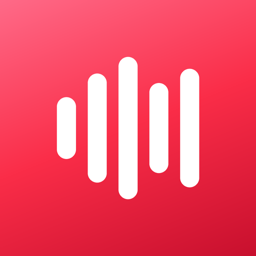
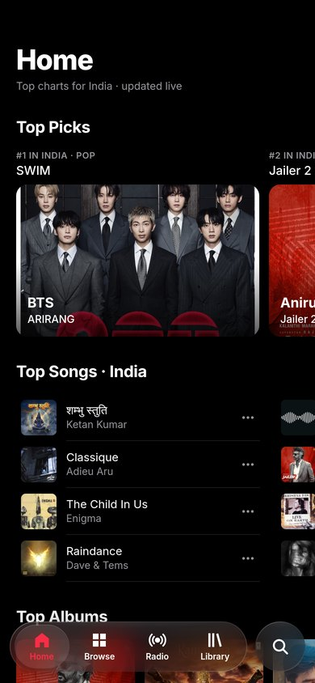
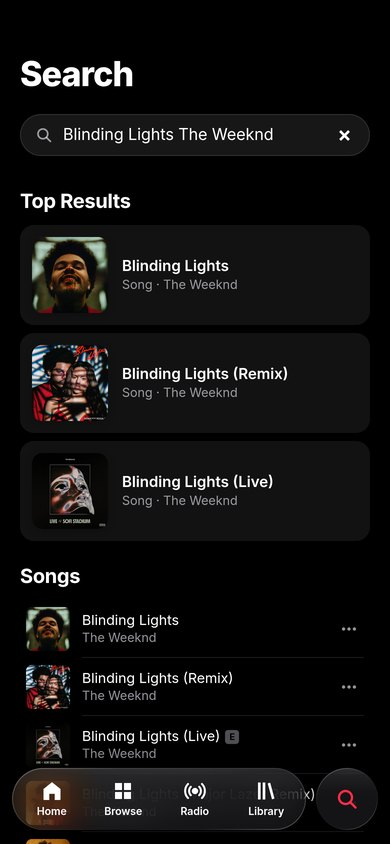
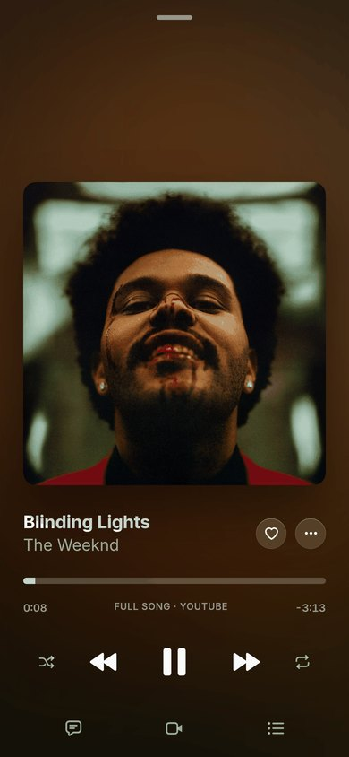
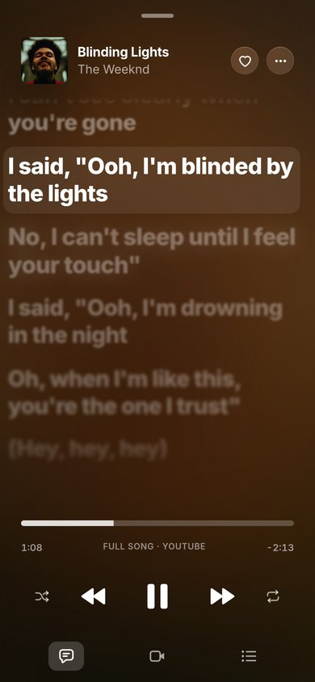

# BeatMusic

**A free, open-source YouTube Music player for Android with an Apple-Music-style look, Liquid Glass and synced lyrics.**

Better fork of [BitChord](https://github.com/kushagrasinghx/BitChord) by [kushagrasinghx](https://github.com/kushagrasinghx) · Developed by [KyotoByte](https://github.com/KyotoByte)

**[Download for Android](https://github.com/KyotoByte/BeatMusic/releases/latest)** · **[Open the web version](https://kyotobyte.github.io/BeatMusic/)**

   

BeatMusic on a phone: Home · Search · Now Playing · Lyrics (web version)

## Features

- **Play anything on YouTube Music**: search, browse, charts and radio, with no ads. Google sign-in is optional.
- **Apple-Music-style design**: Home, Browse, Radio, Library and Search tabs, a pink-red accent and the Inter font.
- **Liquid Glass** (Android 12+): live blur and refraction on the tab bar, mini player and top bars, which fold into one glass capsule as you scroll. Toggle it in Settings → Appearance.
- **Synced lyrics**: full screen, word by word where available. Tap a line to jump to it.
- **Gapless playback, crossfade and Automix** (DJ-style transitions).
- **Offline downloads, local music**, sleep timer, equalizer and playback speed.
- **Last.fm / ListenBrainz scrobbling** and Discord Rich Presence.
- **Built-in updates**: Settings → Updates → Check for updates.

## Download

Get the APK from the **[latest release](https://github.com/KyotoByte/BeatMusic/releases/latest)**:

| File | For |
|---|---|
| `BeatMusic-1.0-arm64-v8a.apk` | **Almost every phone. Pick this one.** |
| `BeatMusic-1.0-armeabi-v7a.apk` | Older 32-bit phones |
| `BeatMusic-1.0-x86_64.apk` | Emulators and Chromebooks |
| `BeatMusic-1.0-universal.apk` | Any device (bigger download) |

Android 8.0 or newer. Allow "Install unknown apps" if Android asks. New versions install over the old one and keep your library.

## Web version

**[kyotobyte.github.io/BeatMusic](https://kyotobyte.github.io/BeatMusic/)**: the same look in any browser, installable as an app. It has search, full songs, synced lyrics, a queue and a library. The source is in [`site/`](site).

## Build

JDK 17 + Android SDK, then `./gradlew :app:assembleProdRelease` (signing: see `keystore.properties.example`).

## Credits

BeatMusic is built on the work of these open-source projects. Thank you all!

**Based on**
- [**BitChord**](https://github.com/kushagrasinghx/BitChord) by [kushagrasinghx](https://github.com/kushagrasinghx) and the [BitChord contributors](https://github.com/kushagrasinghx/BitChord/graphs/contributors). BeatMusic is a better fork of its source code (GPL-3.0).

**Projects BitChord builds on** (BitChord is an original project, not a GitHub fork; these are the projects whose code or libraries it uses)
- [InnerTubeX](https://github.com/MetrolistGroup/innertubex) by [MetrolistGroup](https://github.com/MetrolistGroup): the YouTube Music API client, from [Metrolist](https://github.com/MetrolistGroup/Metrolist), which itself builds on [InnerTune](https://github.com/z-huang/InnerTune) by [z-huang](https://github.com/z-huang) and [OuterTune](https://github.com/OuterTune/OuterTune) by [DD3Boh](https://github.com/DD3Boh) and [mikooomich](https://github.com/mikooomich)
- [Kizzy](https://github.com/dead8309/Kizzy) by [dead8309](https://github.com/dead8309): Discord Rich Presence (ported via Metrolist)
- [Convx](https://github.com/cosmictaserdev-creator/Convx): module sources and the QuickJS engine
- [Echo-Music](https://github.com/EchoMusicApp/Echo-Music): Liquid Glass integration
- [Orchard](https://github.com/SFG5453/Orchard) by SFG5453: Automix track analysis design
- [decent-player](https://github.com/Ma145/decent-player) by Ma145: USB audio concepts
- [am-lyrics](https://github.com/binimum/am-lyrics) by [binimum](https://github.com/binimum): Apple-style lyrics animation

**Libraries**
- [Liquid Glass (Backdrop)](https://github.com/Kyant0/AndroidLiquidGlass) by [Kyant0](https://github.com/Kyant0): the glass effect
- [NewPipe Extractor](https://github.com/TeamNewPipe/NewPipeExtractor) by TeamNewPipe
- [AndroidX Media3 / ExoPlayer](https://github.com/androidx/media), with an FFmpeg decoder built from [librempeg](https://github.com/librempeg/librempeg)
- Jetpack Compose, [Haze](https://github.com/chrisbanes/haze), [Coil](https://github.com/coil-kt/coil), Ktor, OkHttp, [QuickJS-kt](https://github.com/dokar3/quickjs-kt), Rhino and ONNX Runtime
- [Beat This!](https://github.com/CPJKU/beat_this) (CPJKU) and [Open-Unmix](https://github.com/sigsep/open-unmix-pytorch) (sigsep) models for Automix
- [Inter](https://github.com/rsms/inter) font by Rasmus Andersson (SIL Open Font License 1.1)

**Lyrics sources** (from BitChord): [LRCLIB](https://lrclib.net), [lrc.red](https://lrc.red), [BiniLyrics](https://github.com/binimum), [BetterLyrics](https://github.com/better-lyrics/better-lyrics), PaxSenix, [LyricsPlus](https://github.com/ibratabian17/YouLyPlus), [SimpMusic](https://github.com/maxrave-dev/SimpMusic), [Unison](https://unison.boidu.dev), Megalobiz, KuGou, Musixmatch and Genius.

**Web version**: [Deezer API](https://developers.deezer.com) and [iTunes Search](https://performance-partners.apple.com/search-api) for music data, [LRCLIB](https://lrclib.net) for lyrics, public [Piped](https://github.com/TeamPiped/Piped) servers to find songs, the [YouTube IFrame Player](https://developers.google.com/youtube/iframe_api_reference) to play them, and the Inter font.

## License

[GPL-3.0](LICENSE), the same as BitChord. Copyright © KyotoByte and the authors of the original source code.

BeatMusic is not affiliated with, endorsed by or connected to Apple, YouTube or Google. "Apple-Music-style" describes the design only; no Apple logos, fonts or trademarks are used.
